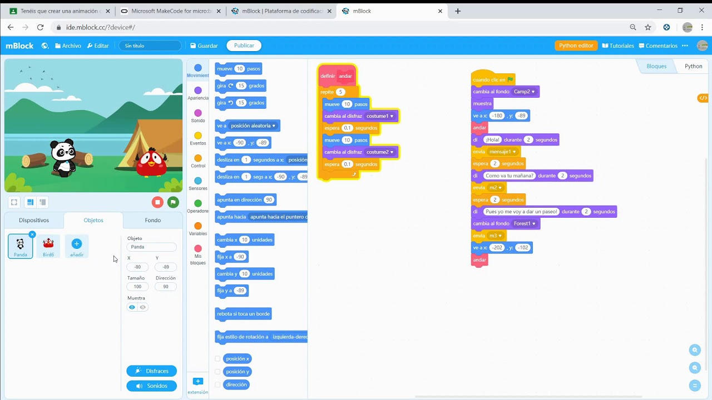
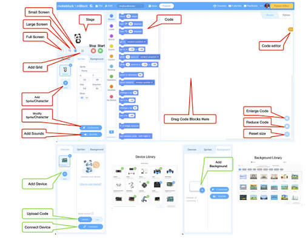

# mBlock Coding Workspace for Learning and Robotics

mBlock combines visual programming with text-based coding for educational projects.
Create interactive scenes, explore programming concepts, and control supported robots and boards.

[](https://github.com/mblock-ide/mblock-coding/releases/)

## Learning Through Programs

The mBlock coding workflow lets learners assemble instructions as blocks and observe their effects.
Projects can connect an on-screen activity with inputs and outputs on a physical device.

A useful lesson starts with a specific behavior to explain.
Students can predict the result, run the program, and compare the observation with their prediction.

### Concepts to Explore

- Sequence: arrange actions in the order they should happen.
- Repetition: repeat a behavior without duplicating every instruction.
- Conditions: choose an action based on an input.
- Variables: retain a value for use later in the program.
- Events: start a response when something happens.
- Debugging: change one part and observe the effect.



## Workspace and Platform Choices

mBlock software is available through a web editor, desktop clients, and mobile applications.
Choose the environment that matches the computer, device, and lesson requirements.

| Environment | Useful role | Dependency to check |
| --- | --- | --- |
| Web editor | Browser-based block programming | Supported browser and device connection method |
| Desktop client | Local project editing on Windows or Mac | Compatible operating system and processor |
| Python editor | Text-based exercises and supported device programming | Python environment and required libraries |
| Mobile application | Coding activities on phones and tablets | Supported device, operating system, and hardware connection |

The official web version supports Windows, Mac, Linux, and Chromebook environments.
Chrome is the recommended browser on the download page.

The desktop client and web editor have different distribution and update paths.
A desktop version number should not be used to identify the current mobile application.

### Browser and Hardware Access

A browser project that only uses the stage has different requirements from a project that connects to a robot.
Device access may require a connection service or a supported browser capability.

mLink is the connection driver provided for the mBlock web version.
Check the instructions for the exact board and connection type before a classroom session.

## Sprites, Devices, and Extensions

The selected programming target determines which commands are available.
A sprite controls a character on the stage; a device target exposes the features of the selected hardware.

### Choose the Target First

1. Identify whether the project controls a sprite or a physical device.
2. Select the matching sprite or device in the workspace.
3. Add the extension needed by the activity.
4. Check that the expected categories and blocks appear.
5. Test a small behavior before combining several subsystems.

mBlock Makeblock projects can use supported products such as mBot, mBot2, and Codey Rocky.
Support also extends to selected third-party boards through the available device library and extensions.

### Extension Dependencies

Extensions can add device commands or specialized services.
The extension, firmware, programming mode, and connection method must work together.

Keep a note of the extensions used when preparing a project for another class.
Check whether a feature depends on an account, network access, or an external service.

## Live Mode and Upload Mode

Live mode supports interactive testing while the device remains connected to the computer.
It is useful when the stage or computer needs to participate in the activity.

Upload mode transfers a compatible program to the device.
The uploaded program can then run independently where the selected hardware and program support that behavior.

### Match the Mode to the Lesson

- Use Live mode for immediate experiments with a connected device.
- Use Upload mode for a supported standalone robot activity.
- Check which blocks become unavailable when changing modes.
- Follow the device-specific firmware requirements.
- Retest the program after switching targets or modes.

The same project idea may need different commands in each execution environment.
A library available to computer-side Python may not exist in a device's MicroPython environment.



## Python Programming

The mBlock IDE includes a dedicated Python editor for text-based exercises.
Use it to study expressions, variables, loops, and functions before adding hardware-specific behavior.

This example calculates the average of three sample measurements:

```python
readings = [18, 21, 24]
average = sum(readings) / len(readings)
print("Average:", average)
for reading in readings:
    print("Above average:", reading > average)
```

The values are a small example dataset rather than live sensor readings.
The code uses ordinary Python and does not require a robot library.

### From Blocks to Text

Compare the purpose of a block sequence with the corresponding text-based logic.
Identify the event, changing values, repeated actions, and stopping condition.

Python indentation expresses structure.
Keep related statements at the same indentation level and check error messages before changing unrelated code.

## CyberPi and Device Libraries

Device programming needs the library supplied for the selected controller.
The Python editor's supported execution modes determine which libraries are usable.

For CyberPi, the cyberpi library provides access to device functions.
With CyberPi connected and the library available, this short Live-mode example changes its LED pattern:

```python
import cyberpi
from time import sleep
cyberpi.led.show("r r r r r")
sleep(1)
cyberpi.led.show("g g g g g")
```

The program displays red lights and then changes them to green after one second.
These commands are specific to CyberPi and should not be treated as a general Arduino or mBot API.

### Test One Output at a Time

Confirm a simple output before combining it with sensors, events, or movement.
Once the basic connection works, add the next behavior and explain what should change.

## AI and Data Activities

mBlock 5 supports extensions for activities involving artificial intelligence and connected devices.
Choose a task that students can describe and evaluate with observable examples.

For a classification activity, collect varied examples and reserve some for testing.
Try inputs that differ in lighting, background, or sound conditions.

A successful classroom demonstration does not establish reliability in every environment.
Discuss the examples that cause mistakes and how the training data could improve.

### Network and Service Requirements

Some activities rely on online services or account-based functionality.
Check availability and service usage information before planning an activity around them.

Prepare a simpler local exercise when the learning objective does not require a cloud service.
This keeps the lesson focused on the programming concept being taught.

## Project Resources and Classroom Preparation

Record the device model, extensions, execution mode, and intended result with each lesson.
Include the smallest useful test that demonstrates the connection is working.

- Open the project on the computers that learners will use.
- Check that required devices appear in the device library.
- Confirm connection permissions and any required driver.
- Verify that the expected firmware and mode are selected.
- Keep an editable copy of the project before making classroom changes.

## Versions and Source Availability

The stable desktop version checked for this guide is V5.6.0 in the mBlock 5 series.
Web, desktop, and mobile release histories should be checked separately.

The public legacy mBlock repository contains an older Scratch 2.0-based generation.
It does not provide the complete source tree or build instructions for the current mBlock 5 desktop client.

## Development and Licensing

Makeblock develops and distributes mBlock.
An individual original author of the application has not been confirmed.

Review the terms supplied with the application, extensions, and project resources you use.
Licensing information for an older source release should not automatically be applied to a newer product generation.

## Related Search Terms

mblock coding, mblock ide, mblock software, mblock makeblock, mblock 5, education, programming, blocks, visual, robots, ide, editor, programming-language
